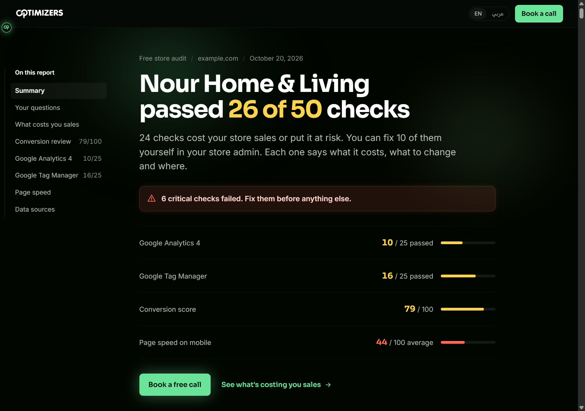
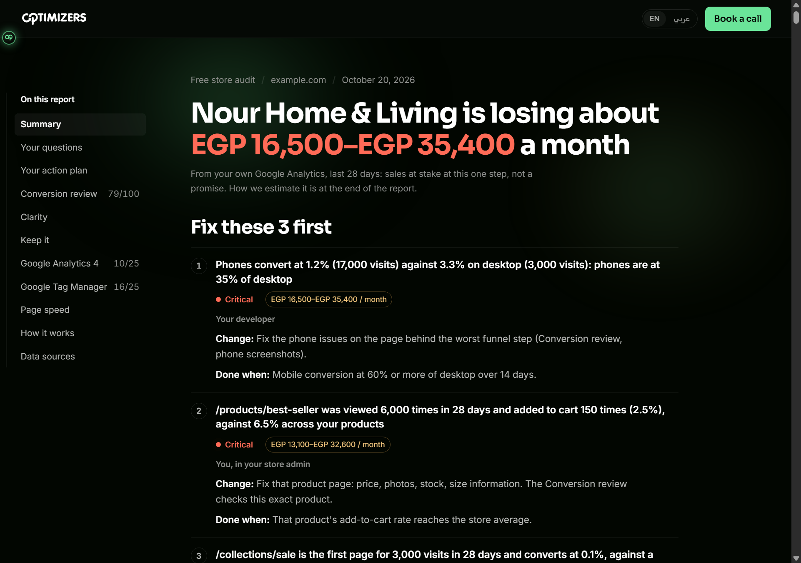
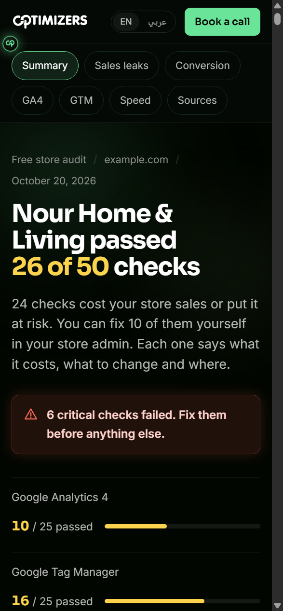
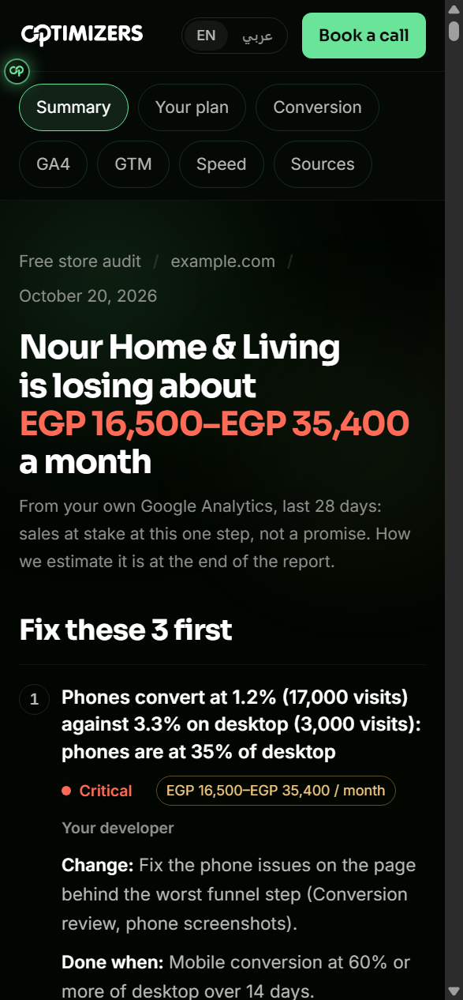
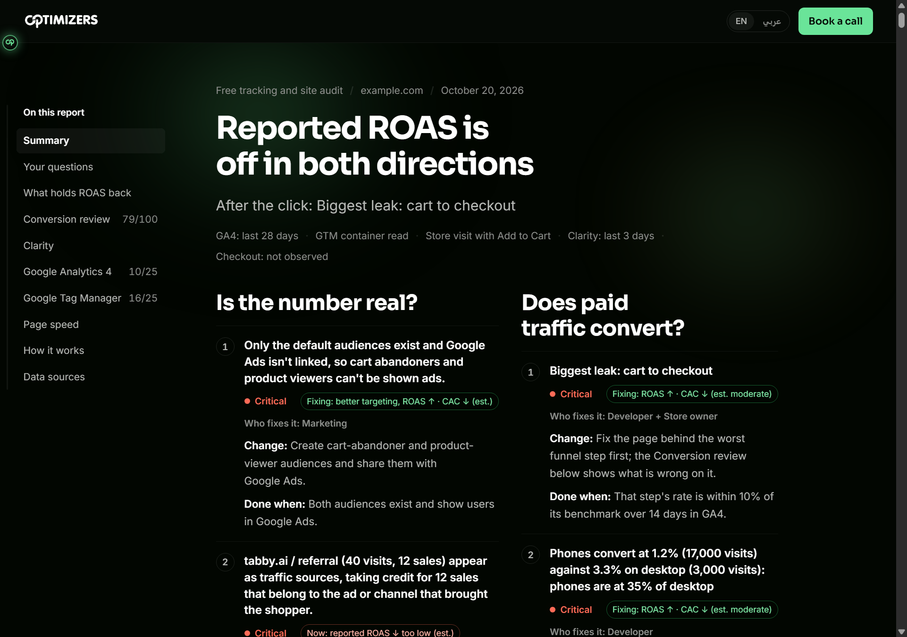
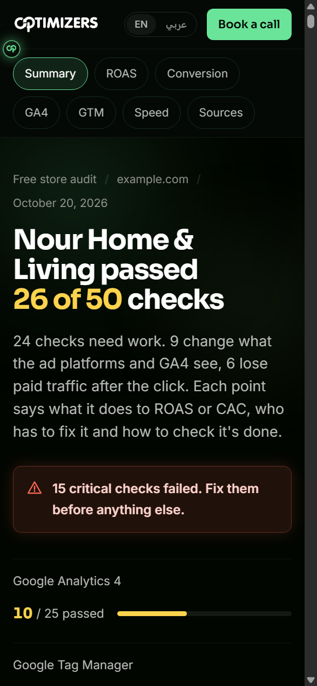
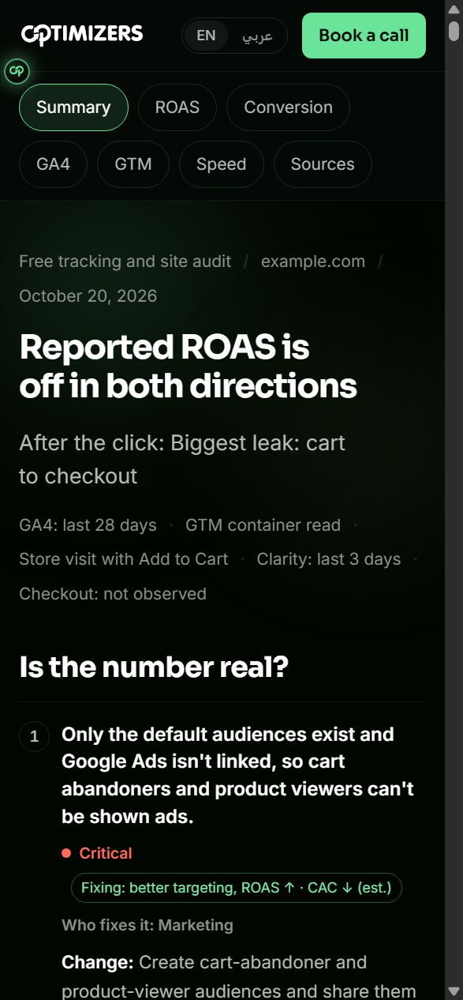

# Before / after: store owner and media buyer reports

Rendered 2026-10-20 from the same sample data (`npm run preview-report -- --path=tracking --role=<role> --fud=output/fud-tharaa.shop-result.json --no-ar`, plus `--clarity` for "after"). "Before" is commit 5640446, built in a separate worktree. English side shown; finding text is fixture text, a real run writes it for the reader and translates it.

## Store owner

| Before | After |
|---|---|
|  |  |
|  |  |

**First screen, before:** "passed 26 of 50 checks", a red critical callout, four score bars. The money appeared in "What's costing you sales", two screens down.
**First screen, after:** "is losing about EGP 16,500–35,400 a month", its GA4 source and "not a promise" right under it, then "Fix these 3 first" with who / change / done-when. The pass count is a small line.

### The 20 ICP1 points, and where each one lands now

| # | Point | Where it is in the report now |
|---|---|---|
| 1 | Who he is (does it himself, phone, no code) | Owner-only points (SO-*) written in his words; "You, in your store admin" vs "Your developer" on every fix; phone-first layout checked at 390px |
| 2 | Fit (GCC, Salla/Zid, GA4 often missing) | "In your Salla, Zid or Shopify admin. No code." group; without GA4 the headline switches to the top finding and says how to get money figures |
| 3 | Wants: what's costing sales, fix it himself | The headline is the money; the action plan splits "You can do these yourself" / "Send these to your developer" |
| 4 | Pains, ranked | Help from see to fix: change + done-when on every fix. Believable money: one range, GA4 source, method at the end. Reason to come back: not built (one audit per site, decided by Omar 2026-10-20). Payments and copy: SO-CRO points (mada/Apple Pay/Tabby/Tamara, COD fee, delivery cost, Arabic titles) |
| 5 | What makes him buy (money number, seasons, checkable proof) | Money headline; "Let us fix it: book a free call" as one of two equal paths. Seasons: not added (no season line yet) |
| 6 | What makes him leave (contradicting numbers, English on Arabic trust moments, disprovable findings) | One money range, never summed; "What we couldn't check" strip; points that need admin access say so; Arabic default |
| 7 | Prices | Not in the report (business decision) |
| 8 | Needs from the tool (SAR, one number with source, paste fixes, re-scan, WhatsApp, 375px) | All in, except WhatsApp as the contact route (no number yet, D3) |
| 9 | How to talk to him | Gulf Arabic strings in the new sections; owner brief unchanged for findings |
| 10 | Who he isn't | Unchanged (form's store check) |
| 11 | Success (fix + re-scan in 30 days) | "Done when" on every fix. No re-scan: one audit per site, ever (decided 2026-10-20) |
| 12 | Assessment scores | Not in the report |
| 13 | Still asked for (fix → re-scan loop, 375px, one currency) | 375px checked; one currency. Re-scan loop not built (one audit per site) |
| 14 | What he loves (SAR hero, GCC checks, honest "unavailable") | SAR headline; GCC payment/COD/delivery points; "not available" wording when GA4 or Clarity per-page data is missing |
| 15 | Elevr evidence | Six Elevr checks are owner CRO points (payment logos, instalments, free-delivery threshold, COD fee, WhatsApp on phone, Arabic titles) |
| 16 | Checks to add (ZATCA threshold, SBC badge, STC Pay…) | Payment points added. ZATCA and SBC: not added as points yet |
| 17 | Market size | Not in the report |
| 18 | Payments and abandoned carts | GA4 cart → checkout and checkout → purchase points (code-decided), payment visibility on product and cart |
| 19 | Competitors (differentiate on money + checkout, not SEO) | SEO points dropped from the owner list; money + checkout lead |
| 20 | How to reach him and when | Client email rewritten (money subject, 3 fixes, two links). WhatsApp route waits for D3; no seasonal line yet |

New sections: action plan (you / developer), "What your shoppers did (Clarity)", "What's working: keep it", "How this audit works".

## Media buyer

| Before | After |
|---|---|
|  |  |
|  |  |

**First screen, before:** the same "passed 26 of 50" opening as every reader; the ROAS verdict and the two lanes sat in "What's holding your ROAS back", below the questions.
**First screen, after:** the ROAS verdict as the headline ("Reported ROAS is off in both directions"), the first post-click leak under it, a scan-status line (GA4, GTM, store visit, Clarity, checkout not observed), the two questions side by side with ROAS/CAC direction and who fixes it, "Get the summary to send the store owner" as the main button.

| Buyer need (ICP2) | Where it is now |
|---|---|
| Is the number real? | Left column + buyer GTM/web-code points (purchase once per platform, event_id dedupe, click IDs, value/currency); 13 new GA4 facts for paid data |
| Does paid traffic convert? | Right column + paid-only GA4 facts (paid funnel, paid landing pages, paid phone vs desktop, paid new vs returning, bot-like paid sessions) |
| Proof the owner will accept | Main button jumps to "Send this to the store owner"; every fix names who fixes it; method box tells him to confirm in Events Manager / Test Events |
| Direction, never a number | Hero line says so; chips show direction only |
| Ad vs landing page, coupon | New optional form fields (ad promise, coupon) feed the landing-page and promo-code points |
| Snap / TikTok, in-app browsers | GTM points per platform; Clarity section shows the share of sessions in Facebook/Instagram in-app browsers |
| Clean site | Verdict says "Tracking and the site passed: look at targeting and creative" |

## Not done

- WhatsApp contact route (needs the number, D3).
- Season line before White Friday / Ramadan, ZATCA and SBC owner points.
- Two buyer GA4 points still judged by the model (MB-GA4-10 session breaks between domains, MB-GA4-16 funnel event counts), and the six buyer CRO points that read GA4 (they sit in Website, where facts aren't applied).
